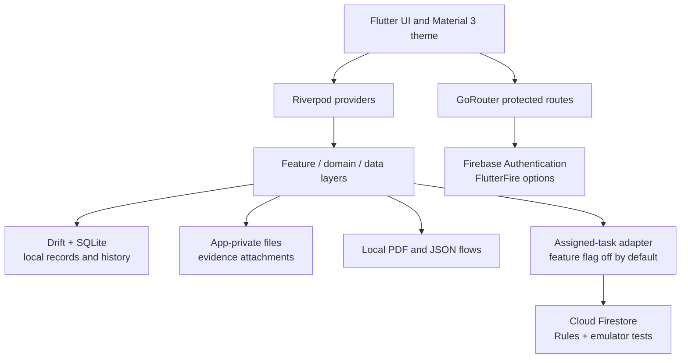

<div align="center">

# LIFE OS

### Local-first planning, tracking, and personal routines for Android

An Android-first Flutter prototype for organizing tasks, routines, goals, habits, prayer schedules, wellness records, and reflective progress while keeping personal records local by default.

[](https://flutter.dev/)
[](https://dart.dev/)
[](https://firebase.google.com/)
[](https://drift.simonbinder.eu/)
[](#-implementation-status)

</div>

> LIFE OS is an active prototype, not a production-ready or published application. Its local workflows are implemented progressively; live Firebase setup, device behavior, production authorization, and release hardening still require external verification.

## Contents

- [🚀 Project Overview](#-project-overview)
- [✨ Key Features](#-key-features)
- [📊 Implementation Status](#-implementation-status)
- [🧩 Architecture](#-architecture)
- [🛠️ Technology Stack](#️-technology-stack)
- [🧪 Engineering Case Studies](#-engineering-case-studies)
- [📁 Project Structure](#-project-structure)
- [⚙️ Development Setup](#️-development-setup)
- [🔥 Firebase Configuration](#-firebase-configuration)
- [🔐 Security, Privacy and Data Handling](#-security-privacy-and-data-handling)
- [👨‍💻 About the Developer](#-about-the-developer)
- [📜 Asset Attribution and License](#-asset-attribution-and-license)

## 🚀 Project Overview

LIFE OS combines structured planning with local personal tracking. The app uses Drift/SQLite for the local source of truth and Firebase Authentication for the protected account boundary. A separately gated Firestore adapter exists for assigned-task projection; general personal-record synchronization is not implemented.

The project is intentionally honest about its boundary:

| Area | Current state |
| --- | --- |
| Personal records | Local-first tasks, routines, goals, habits, history, measurements, prayer, fasting, sleep, workouts, evidence metadata, reports, and backups |
| Authentication | Firebase email/password code and protected routes; live project activation and account verification remain external setup work |
| Assigned tasks | Experimental Firestore projection with local rules and emulator coverage; feature flag off by default and production state unverified |
| Android readiness | Device-level notification, Usage Access, file-picker, and native PDF behavior still need verification |
| Release readiness | The current release build uses debug signing and example application ID `com.example.life_os`; it is not store-ready |

Further reading: [implementation status](docs/IMPLEMENTATION_STATUS.md), [architecture decisions](docs/DECISIONS.md), and the [project specification](docs/PROJECT_SPEC.md). The specification contains planned requirements and should not be read as a list of delivered features.

## ✨ Key Features

| Capability | What is implemented | Status |
| --- | --- | --- |
| Planning | Tasks, routines, goals, habits, recurrence, completion history, measurements, local insights, and approval-based planning flows | Implemented locally |
| 15-day task import | XLSX, CSV, TXT, DOCX, and selectable-text PDF import with preview, editing, validation, capacity warnings, explicit approval, and idempotent local writes | Implemented locally; native file-picker/PDF behavior needs device verification |
| Rolling carryover | Approval-only proposal for unfinished tasks from prior imported plans | Partial; not a complete adaptive planner |
| Prayer | Manual Azan/Jamaat schedules, prayer logs, timezone-aware reminders, dismissal, and snooze | Implemented locally; Android delivery needs device verification; prayer times are not calculated |
| Wellness | Local fasting, sleep, and workout records | Implemented locally |
| Evidence | Up to five local task-completion attachments with type, size, and basic-content validation | Partial; no camera capture, history preview, upload, retention UI, or cleanup after task deletion |
| Screen Time | Android Usage Access query and date-filtered foreground-app summaries | Implemented locally; permission and device behavior are unverified and results are not persisted |
| Reports and backup | 15-day PDF preview/save/print/share and account-scoped JSON backup/restore | Implemented locally; evidence bytes are excluded and restore is not a complete recovery system |
| Firebase access | Email/password authentication, protected routing, and a fail-closed setup screen | App code implemented; live project, provider, account, and server enforcement remain unverified |

### Not available or not enabled

- General synchronization of personal records, history, evidence, backups, reports, Screen Time, or wellness data is not implemented.
- Assigned-task sharing is experimental, default-off, and not a supported production synchronization feature.
- Learning-session workflows, full evidence lifecycle management, shared progress/comparison/leaderboard/analytics, and complete adaptive planning remain incomplete or planned.
- Local SQLite and evidence files are not app-level encrypted. Android backup behavior needs a deliberate policy review before real sensitive records are collected.

## 📊 Implementation Status

The current implementation status is recorded in [docs/IMPLEMENTATION_STATUS.md](docs/IMPLEMENTATION_STATUS.md), updated 2026-10-20 (Asia/Dhaka). The project is best understood as a working local-first prototype with several implemented feature slices and explicit external verification gates.

### Recorded verification evidence

The repository records the following local results from 2026-10-20:

- `flutter analyze` completed with no issues.
- The full Flutter test suite passed 153 tests.
- `flutter build apk --release` succeeded with a recorded 76.2 MB APK.
- Cloud Functions allowlist tests passed 3/3.
- Firestore Emulator Rules tests passed 11/11 against the isolated `demo-life-os` project using synthetic identities.

These are recorded local results, not a claim of hosted CI success. The GitHub Actions workflow runs analysis and Flutter unit tests with a temporary Firebase stub; it does not run the Firestore Emulator suite. The emulator result does not prove deployed production Rules, memberships, live authentication, or cross-device behavior.

## 🧩 Architecture

The app is organized around a Flutter UI, Riverpod state/dependency management, GoRouter-protected navigation, feature/domain/data layers, and a Drift-backed local database. Firebase remains a separate boundary for authentication and the experimental assigned-task projection.



Important boundaries:

- Drift/SQLite is the local source of truth for personal records and history. Local ownership and visibility checks are application safeguards, not a server security boundary.
- Firebase Authentication initializes from generated `DefaultFirebaseOptions.currentPlatform` and guards the app routes. There is no public account-creation screen.
- The Firestore adapter covers assigned tasks only. It is not a general sync engine, durable offline outbox, conflict resolver, or verified cross-device synchronization system.

## 🛠️ Technology Stack

| Layer | Technologies | Role |
| --- | --- | --- |
| App platform | Flutter, Dart, Android SDK | Android-first client application |
| UI and navigation | Material 3, Riverpod, GoRouter | Theming, dependency/state management, and protected routes |
| Local persistence | Drift, SQLite, `path_provider` | Versioned schema, reactive local reads, migrations, and UID-scoped records |
| Authentication | Firebase Core, Firebase Authentication, FlutterFire CLI | Email/password auth and generated platform configuration |
| Experimental remote boundary | Cloud Firestore, Firebase Functions, local Rules tests | Assigned-task projection and server-side allowlist code; deployment remains unverified |
| Planning and files | `file_picker`, CSV/XML/archive parsing, `flutter_pdf_text` | Local task-plan import and source-material suggestions |
| Notifications and time | `flutter_local_notifications`, `timezone` | Optional Android reminders using injected, testable scheduling logic |
| Reports and export | `pdf`, `printing`, local JSON services | Fifteen-day report flow and account-scoped backup/restore |

## 🧪 Engineering Case Studies

### 🕰️ Fixing timezone-dependent Flutter tests

**Problem:** Prayer reminder fixtures used Dart's machine-local `DateTime` constructor. The same intended Dhaka time could be interpreted differently on a Bangladesh-time machine and a hosted Linux runner.

**Approach:** The tests were updated to use explicit UTC instants, derive local date keys through the configured timezone, and assert the reminder behavior through fake gateway and preference-store boundaries.

**Demonstrates:** Deterministic time-dependent testing, separation of host timezone from product timezone, and careful distinction between local evidence and hosted CI evidence. The case study records focused tests at 11/11 and the full suite at 153/153, while hosted CI remains unconfirmed and device delivery is outside the test scope.

→ Read the full [timezone-dependent testing case study](docs/case-studies/timezone-dependent-prayer-tests.md).

### 🧭 Human-reviewed 15-day task import

**Problem:** Source material in several file formats must become dated tasks without silently changing a user's plan or losing existing history.

**Approach:** LIFE OS parses supported files locally, generates deterministic suggestions, presents all 15 dates for review, validates fields/dependencies/capacity, and saves only after explicit approval. Drift writes task rows and the import receipt transactionally, with an exact-identity duplicate guard.

**Demonstrates:** Human-in-the-loop product design, defensive parsing, idempotent local persistence, and testable boundaries for file extraction. The importer does not send files to an AI service; scanned PDFs, native Android extraction, and actual picker behavior still require device verification.

→ Read the full [human-reviewed task import case study](docs/case-studies/human-reviewed-15-day-task-import.md).

### AI-assisted engineering workflow

Repository evidence supports describing Codex as part of a practical workflow involving source review, implementation review, debugging, testing, documentation, and validation. The case-study records do not establish that Codex authored the entire application or any specific historical feature without additional evidence.

## 📁 Project Structure

```text
life_os/
├── lib/
│   ├── app/                 # Theme, app shell, and GoRouter navigation
│   ├── core/                # Shared widgets and Drift database
│   └── features/            # Auth, planning, prayer, tracking, reports, and more
├── functions/               # Firebase Authentication blocking-function code/tests
├── security-tests/           # Firestore Rules emulator tests and fixtures
├── test/                    # Flutter unit, repository, and widget tests
├── docs/
│   ├── case-studies/        # Engineering evidence and implementation narratives
│   └── IMPLEMENTATION_STATUS.md
├── firestore.rules          # Local default-deny Rules for the gated projection
├── firebase.json             # Firebase CLI, FlutterFire mapping, and emulator config
├── pubspec.yaml              # Flutter/Dart dependencies
└── README.md
```

## ⚙️ Development Setup

### Prerequisites

Install Flutter/Dart, Android Studio or Android SDK tools, Node.js, npm, the Firebase CLI, and Java 21 or later for Firestore Emulator tests. Run commands from the repository root.

### Clean-checkout order

For a real configured Android app, follow this order:

```bash
# 1. Install Flutter project dependencies
flutter pub get

# 2. Install the project-specific FlutterFire CLI
dart pub global activate flutterfire_cli

# 3. Configure your Firebase project and Android app
flutterfire configure --project YOUR_PROJECT_ID --platforms android

# 4. Analyze and test the configured checkout
flutter analyze
flutter test

# 5. Build only after real Firebase configuration is present
flutter build apk --release
```

`flutterfire configure` generates the ignored client files `lib/firebase_options.dart` and `android/app/google-services.json`. Do not invent project IDs or credentials; use the Firebase project and Android app that you are authorized to configure. The current release build still uses debug signing and the example application ID `com.example.life_os`, so a successful APK build is not a store-release verification.

### Additional local checks

Cloud Functions unit tests:

```bash
node functions/test/auth_allowlist.test.js
```

Firestore Rules tests require the Firestore Emulator and the security-test dependencies. Install them once, then run the isolated test project:

```bash
npm ci --prefix security-tests
firebase emulators:exec --project demo-life-os --only firestore "node security-tests/firestore.rules.test.cjs"
```

The test identities and `demo-life-os` project are synthetic/local fixtures. Do not replace the isolated test project with a production project.

### CI boundary

The GitHub Actions workflow at [.github/workflows/flutter-ci.yml](.github/workflows/flutter-ci.yml) runs `flutter pub get`, creates a temporary ignored `lib/firebase_options.dart` stub, then runs `flutter analyze` and `flutter test`. The stub intentionally throws and cannot initialize a real Firebase app. The workflow does not run emulator tests, does not build a release APK, and does not validate a connected Firebase configuration. No successful hosted CI run is established by this repository.

## 🔥 Firebase Configuration

Firebase client configuration is project-specific. Create or select an authorized Firebase project and Android app, enable Email/Password sign-in if required, then run the FlutterFire command in the setup sequence above.

The repository expects these generated files locally:

| File | Purpose | Git status |
| --- | --- | --- |
| `lib/firebase_options.dart` | FlutterFire `DefaultFirebaseOptions.currentPlatform` used during app initialization | Ignored; generate locally |
| `android/app/google-services.json` | Android Firebase application configuration | Ignored; generate locally |

The tracked `firebase.json` records CLI mappings, Functions, Firestore Rules, and emulator settings; it does not replace the generated client files. Never place service-account credentials in the app. Client API keys and app IDs identify a Firebase project but are not server credentials; authorization still depends on Authentication, Rules, and server-side configuration.

The Functions in `functions/` use Firebase Authentication blocking events and the private `LIFE_OS_ALLOWED_EMAILS` deployment parameter. The app has no public sign-up screen, but the allowlist is not enforced until the blocking functions are deployed and active. These functions require Firebase Authentication with Identity Platform, and deployment requires the Blaze billing plan; review current pricing and configure budget alerts before enabling paid services.

### Assigned-task membership provisioning

The client cannot create or edit `lifeOsMembers` documents. An authorized Firebase administrator must independently verify the intended Auth UIDs, then create one record per paired user at `lifeOsMembers/{uid}` with `active: true` and reciprocal `peerUid` values. Review both identities and the deployed `firestore.rules` before enabling shared tasks. Do not infer membership from an email allowlist, accept a UID from the client, or activate arbitrary users. This repository does not implement automatic provisioning, and production membership and Rules remain unverified.

Running or deploying Firebase services changes a remote project. Explicitly select and review the target before deployment; no Firebase deployment is part of the local commands above.

## 🔐 Security, Privacy and Data Handling

- The local SQLite database and evidence files are not app-level encrypted. Android's app sandbox and platform storage encryption are not substitutes for a completed threat model and encryption policy for sensitive records.
- Evidence bytes stay in the app-private support directory and are not uploaded. Android backup rules exclude the evidence directory, but Android Auto Backup is not explicitly disabled and the local database may be included in eligible backups.
- JSON backups and PDF reports may contain sensitive personal data. Evidence contents are excluded from JSON backup, and restore behavior should be reviewed before using the feature as disaster recovery.
- Firestore Rules default-deny other document paths and forbid client membership writes. The 2026-10-20 emulator result of 11/11 tests used synthetic identities and does not verify deployed production Rules, memberships, authentication, or cross-device behavior.
- Local owner/visibility checks reduce accidental misuse inside the app but are not a server security boundary. Keep the assigned-task feature flag off until trusted identities, memberships, Rules deployment, and live access tests are independently verified.
- Notification delivery, Usage Access, file-picker behavior, native PDF extraction, backup/restore behavior, and OEM Android behavior require device-level checks. LIFE OS does not claim that a scheduled reminder was delivered merely because it was scheduled.

See [SECURITY.md](SECURITY.md) for responsible-disclosure guidance. GitHub private vulnerability reporting has not been verified as enabled for this repository; do not post exploit details in public issues.

## 👨‍💻 About the Developer

**Abdullah Al Rafid**

This repository demonstrates practical work in Flutter application development, local-first data management, testing, documentation, and responsible AI-assisted engineering workflows.

- [GitHub profile](https://github.com/abdullah-al-rafid)
- [LIFE OS repository](https://github.com/abdullah-al-rafid/life-os)
- [Synthetic Medical Data Generator](https://github.com/abdullah-al-rafid/synthetic-medical-data-generator)

## 📜 Asset Attribution and License

The bundled Noto Sans Arabic and Bengali fonts include SIL Open Font License 1.1 notices in `assets/fonts/`. The repository has no source or license note for `assets/branding/life_os_icon.png` or the derived Android launcher icons. Confirm that the project owner created or may redistribute that artwork before publishing; add attribution if it came from a third party.

No repository license is included. Public visibility does not grant general permission to use, modify, or redistribute this code or its assets. Obtain the owner's license decision before adding a license or granting reuse permission.
